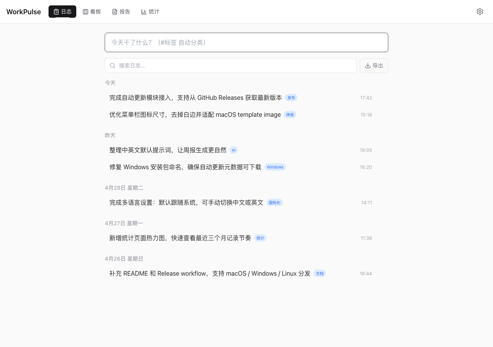
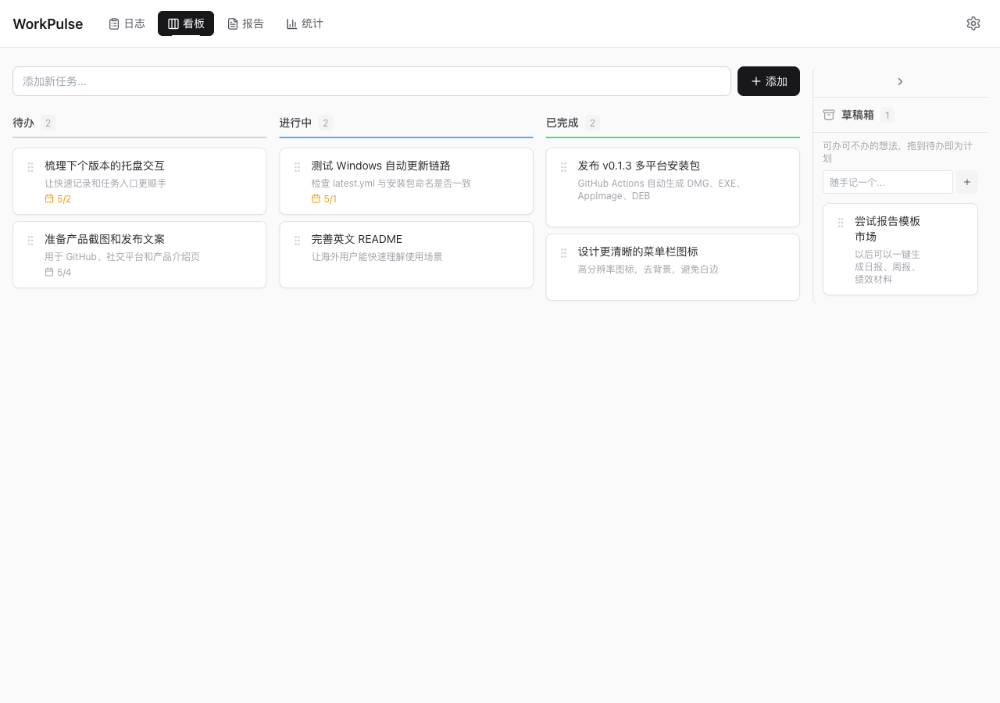
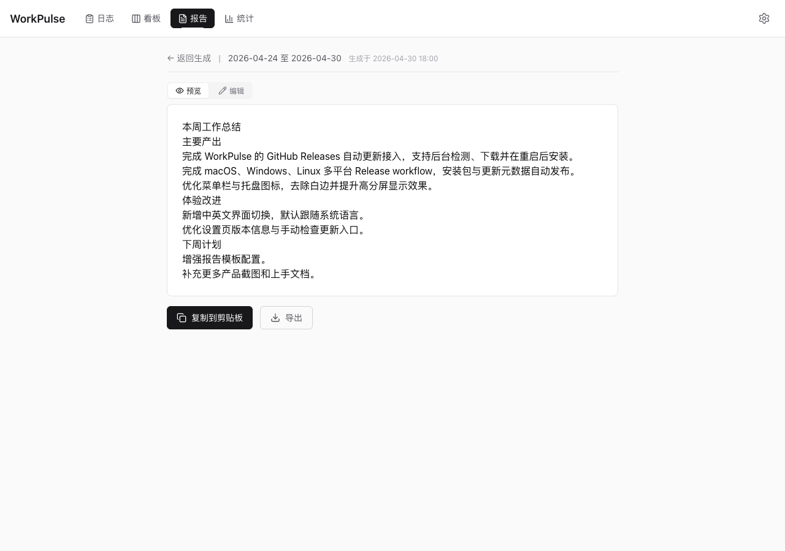
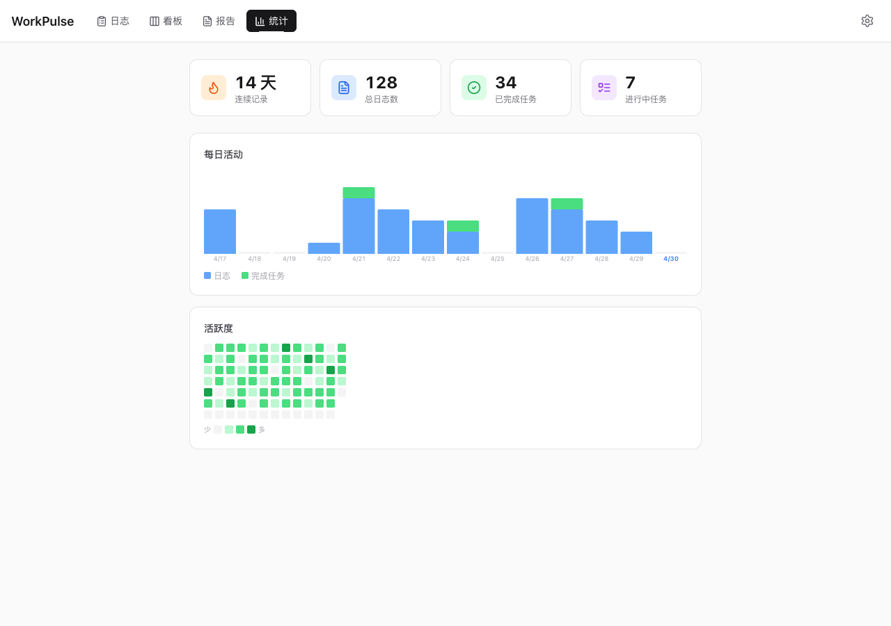

# WorkPulse

[English](./README.en-US.md) | [中文](./README.md)

> Make every effort count

A lightweight desktop app that captures your daily work in seconds — log what you did, track tasks on a kanban board, and generate AI-powered reports.

The name asks the daily question "Did you log it?" — one entry, one visible effort. Built for individual contributors who want a frictionless way to remember what they accomplished each day.

## Screenshots

| Work Log                                            | Kanban                                           |
| --------------------------------------------------- | ------------------------------------------------ |
|  |  |

| AI Report                                           | Statistics                                          |
| --------------------------------------------------- | --------------------------------------------------- |
|  |  |

## Features

**Work Log** — Type what you just did, press Enter. That's it. Supports `#tag` for auto-categorization, full-text search, undo delete, and CSV/Markdown export with categories.

**Kanban Board** — Drag tasks between Todo → In Progress → Done. Includes a draft box for "maybe later" ideas, due date tracking, and inline editing. Completing a task auto-generates a work log entry.

**AI Reports** — Select a date range and generate a structured summary of your work with streaming rendering (thinking-process collapsible). Reports are auto-saved to history on completion and can be previewed, edited, copied, or exported.

**AI Chat** — Built-in multi-conversation chat with provider presets for DeepSeek/OpenAI/Anthropic/Zhipu/Moonshot/Qwen/Gitee/Ollama, connection testing, config import/export, live token usage and cost estimation.

**Calendar** — Manage todos and meetings on a perpetual calendar view with automatic Chinese holiday/substitute-workday data. Meeting reminders fire system notifications ahead of the configured lead time and can also be pushed to your iPhone via Bark.

**Local AI Models** — ONNX model chat, OCR text recognition, PaddleOCR, and XRay image processing. Models download via the hf-mirror.com China mirror into a local folder cache, reused across pages, with WebGPU acceleration and retry on failure.

**Statistics** — 3D contribution graph (React Three Fiber), stacked bar chart, donut breakdown, category distribution, streak counter, with one-click range switching from 1 month to 1 year.

**Quick Capture** — Configurable global shortcuts (`Ctrl+Shift+L` for logs, `Ctrl+Shift+T` for tasks by default) let you record without switching windows. Quick logs also support `#tag` parsing and are accessible from the menu bar tray icon.

**Dark Mode** — System, light, or dark theme with full UI coverage, unified through a design-token color system.

**Languages** — English and Chinese UI with a system-default option. Menus, tray actions, settings, exports, and default AI report prompts follow the selected language.

**Auto Updates** — Packaged builds check GitHub Releases for newer versions, download updates in the background, and install after restart. Settings also includes a manual update check.

**Windows Mica Effect** — Native `backgroundMaterial` (Mica / Mica Tabbed / Acrylic, switchable in Settings) with unified title bar, navigation, and content painting for a seamless frosted-glass desktop integration.

**Brand Visuals** — A unified icon system: a slate-purple monitor with a cyan-to-red pulse waveform and four task-state dots as the main mark, multicolor brand icons across navigation, tray, floating widget, and Touch Bar that brighten automatically in dark mode. MiSans is the default font.

**Liquid Glass Widget** — The radial floating menu and Touch Bar share a liquid-glass finish: dispersion-edged color fringing, Fresnel highlights, and a mouse-following specular glow, all achieved with pure paint layers and no extra material passes. Automatically degrades when "reduce transparency" or "reduce motion" is enabled.

**Theme Transition** — Switching themes triggers a circular reveal expanding from the click point (View Transition), with the background color backfilled during animation so it never reduces to a text-only change. Falls back to a plain transition on unsupported browsers, keyboard activation, and reduced-motion preference. Accent-color changes sync instantly across windows.

## Tech Stack

- **Electron** + **React** + **TypeScript**
- **Vite** via electron-vite for fast builds
- **SQLite** (better-sqlite3) for local-first data storage
- **Zustand** for state management
- **@dnd-kit** for drag-and-drop
- **Tailwind CSS** with a design-token system
- Native `backgroundMaterial` for Windows Mica effect
- **React Three Fiber** + **Three.js** for the 3D contribution graph
- **ECharts** for statistics charts
- **Transformers.js** for local AI model inference (WebGPU)

## Getting Started

```bash
# Install dependencies
npm install

# Run in development
npm run dev

# Build for production
npm run build

# Package for distribution
npm run dist:mac    # macOS (DMG + ZIP, x64 + arm64)
npm run dist:win    # Windows (NSIS installer)
npm run dist:linux  # Linux (AppImage)
```

## Development & Verification

All commands run directly on your machine — no extra manual window confirmation required.

| Command                | Purpose                                                                               |
| ---------------------- | ------------------------------------------------------------------------------------- |
| `npm test`             | Vitest unit tests (`tests/unit`, jsdom + Testing Library)                             |
| `npm run test:watch`   | Watch mode for unit tests, re-running on changes                                      |
| `npm run test:e2e`     | Build first, then launch a real Electron window with Playwright for GUI smoke testing |
| `npm run typecheck`    | TypeScript checks for main and renderer processes                                     |
| `npm run lint`         | Oxlint static checks                                                                  |
| `npm run format:check` | Code and documentation formatting check                                               |
| `npm run build`        | Full build of main / preload / renderer                                               |
| `npm run audit:glass`  | Glass-effect GPU budget audit                                                         |

Unit tests cover animation token contracts, theme-switch ripples and reduced-motion fallback, Toast timer deduplication, command palette execution lock, and accent-color event broadcasting. `tests/setup.ts` supplies the jsdom gaps: `matchMedia` / WAAPI / `scrollIntoView`.

GUI verification checks main window rendering, native View Transition support, whether clicking the theme button triggers a ripple and backfill, whether animations are skipped under reduced-motion preference, and command palette shortcut toggling; screenshots go to `test-results/`. This mode is fully isolated via `WORKPULSE_E2E=1` and a temporary `userData`: it skips single-instance lock, global shortcuts, tray, protocol registration, and update checks, and never touches the real database or registry. On failure, the temporary `userData` is kept and the tail of the main-process log is printed for diagnosis. Put renderer-layer cases in `tests/unit` and window-level cases in `tests/e2e`.

## Installation

### macOS

Because the build is unsigned, macOS Gatekeeper will mark the app as "damaged" on first launch. After dragging `WorkPulse.app` to `/Applications`, run this once in Terminal to clear the quarantine attribute:

```bash
xattr -cr /Applications/WorkPulse.app
```

Then open the app normally.

### Windows

Download the NSIS installer from [Releases](../../releases). Run the installer and follow the prompts. The app will be installed to your Program Files directory.

## Release Builds

GitHub Actions builds release artifacts for macOS, Windows, and Linux when a `v*` tag is pushed, or when the `Release` workflow is run manually.

```bash
npm run release        # interactive version picker; auto commit + tag + push
```

Update [CHANGELOG.md](./CHANGELOG.md) before releasing. The workflow uploads DMG/ZIP, NSIS/portable EXE, AppImage, and DEB artifacts to the GitHub Release. Builds are unsigned by default; add signing secrets later if you need notarized macOS or signed Windows installers.

Packaged apps use the same GitHub Release metadata (`latest.yml`, `latest-mac.yml`, `latest-linux.yml`) for automatic update checks.

## Keyboard Shortcuts

| Shortcut        | Action              |
| --------------- | ------------------- |
| `⌘1` / `Ctrl+1` | Switch to Work Log  |
| `⌘2` / `Ctrl+2` | Switch to Kanban    |
| `⌘3` / `Ctrl+3` | Switch to Reports   |
| `⌘4` / `Ctrl+4` | Switch to Stats     |
| `⌘,` / `Ctrl+,` | Settings            |
| `Ctrl+Shift+L`  | Quick log (global)  |
| `Ctrl+Shift+T`  | Quick task (global) |

## Data & Security

All data is stored locally in SQLite at your system's app data directory. Automatic daily backups are created. API keys are stored through Electron secure storage when available, with migration cleanup for legacy plaintext keys. No cloud, no account, no telemetry.

## License

MIT
