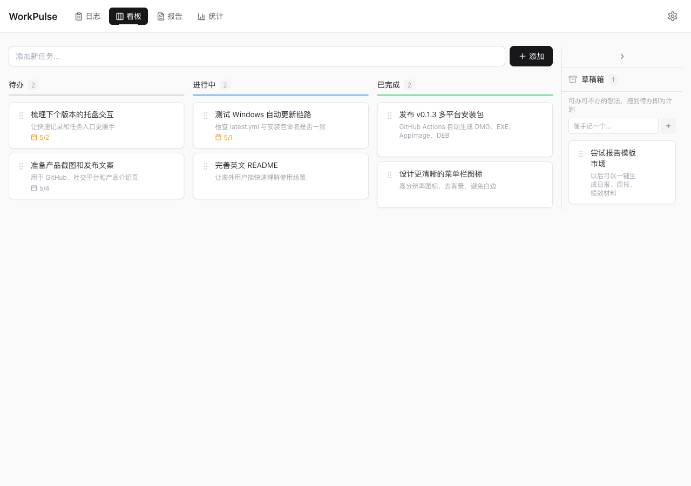
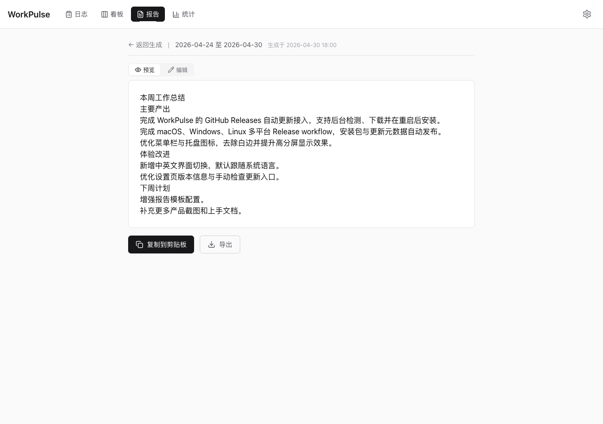

# 记了么 (WorkPulse)

[English](./README.en-US.md) | [中文](./README.md)

> 让每一份努力被看见

一款轻量桌面应用，几秒钟记录你的每日工作——写下做了什么、用看板管理任务、用 AI 生成工作报告。

名字取自每天那句"今天记了么？"——一次记录，一份看得见的努力。为每一个想轻松回顾"今天干了啥"的打工人而生。

## 截图

| 工作日志                                            | 看板                                           |
| --------------------------------------------------- | ---------------------------------------------- |
|  |  |

| AI 报告                                           | 统计                                          |
| ------------------------------------------------- | --------------------------------------------- |
|  |  |

## 功能

**工作日志** — 输入你刚做了什么，按回车，完成。支持 `#标签` 自动分类、全文搜索、撤销删除，以及带分类信息的 CSV/Markdown 导出。

**看板任务** — 在待办 → 进行中 → 已完成之间拖拽任务卡片。有草稿箱存放"以后再说"的想法，支持截止日期和内联编辑。完成任务时自动生成一条工作日志。

**AI 报告** — 选择时间范围，一键生成结构化工作总结。流式渲染（支持思考过程折叠），生成完成自动保存到历史，可预览、编辑、复制或导出。

**AI 对话** — 内置多会话聊天，支持 DeepSeek/OpenAI/Anthropic/智谱/Moonshot/通义/Gitee/Ollama 等供应商预设、连接测试、配置导入导出，实时 Token 统计与成本估算。

**日程日历** — 万年历视图管理待办事项与会议预约，自动接入法定节假日与调休数据；会议开始前按配置的提前量推送系统通知，并可同步推送到 iPhone（Bark）。

**本地 AI 模型** — ONNX 模型对话、OCR 图片文字识别、PaddleOCR、XRay 影像处理。模型经 hf-mirror.com 国内镜像下载并缓存到本地文件夹，跨页面复用，支持 WebGPU 加速与失败重试。

**数据统计** — 3D 贡献图（React Three Fiber）、堆叠柱状图、环形占比、分类分布、连续记录天数，支持近一月到近一年周期一键切换。

**快速记录** — 可配置全局快捷键（默认 `Ctrl+Shift+L` 记日志、`Ctrl+Shift+T` 加任务）让你无需切换窗口即可记录。快速日志同样支持 `#标签` 解析，也可从菜单栏托盘图标操作。

**深色模式** — 跟随系统、浅色、深色三种主题，全界面覆盖，基于设计 Token 统一配色。

**多语言** — 支持中文和英文界面，可跟随系统语言。菜单、托盘操作、设置、导出及默认 AI 报告提示词均随语言切换。

**自动更新** — 打包版本会自动检查 GitHub Releases 新版本，后台下载更新，重启后安装。设置页面也提供手动检查更新。

**Windows Mica 效果** — 原生 `backgroundMaterial`（Mica / Mica Tabbed / Acrylic 可在设置中切换），标题栏、导航栏与内容区统一涂装，毛玻璃质感与桌面环境融为一体。

**品牌视觉** — 全程序图标按同一套语言定制：灰紫显示器 + 青红脉搏波形 + 四色任务点的主标识，导航、托盘、悬浮窗、Touch Bar 多色品牌图标统一，深色主题自动提亮；默认字体 MiSans。

**液态玻璃悬浮窗** — 径向悬浮菜单与 Touch Bar 共用液态玻璃饰面：色散彩边、菲涅尔高光与鼠标跟随镜面反光，全程纯 paint 叠加，不增加额外材质层。系统开启"减少透明度 / 减少动态效果"时自动降级。

**主题切换动画** — 切换主题时从点击位置扩散的圆形揭示过渡（View Transition），动画期间补齐底色避免只剩文字变色；不支持的浏览器、键盘激活与减少动态偏好下回退到普通过渡。强调色变更跨窗口即时同步。

## 技术栈

- **Electron** + **React** + **TypeScript**
- **Vite** (electron-vite) 快速构建
- **SQLite** (better-sqlite3) 本地数据存储
- **Zustand** 状态管理
- **@dnd-kit** 拖拽排序
- **Tailwind CSS** 样式（设计 Token 体系）
- 原生 `backgroundMaterial` Windows Mica 效果
- **React Three Fiber** + **Three.js** 3D 贡献图
- **ECharts** 统计图表
- **Transformers.js** 本地 AI 模型推理（WebGPU）

## 快速开始

```bash
# 安装依赖
npm install

# 开发模式运行
npm run dev

# 生产构建
npm run build

# 打包分发
npm run dist:mac    # macOS (DMG + ZIP, x64 + arm64)
npm run dist:win    # Windows (NSIS 安装包)
npm run dist:linux  # Linux (AppImage)
```

## 开发与验证

所有命令都可直接在本机运行，不需要额外手工点窗口确认。

| 命令                   | 作用                                                          |
| ---------------------- | ------------------------------------------------------------- |
| `npm test`             | Vitest 单元测试（`tests/unit`，jsdom + Testing Library）      |
| `npm run test:watch`   | 单元测试监视模式，改代码即重跑                                |
| `npm run test:e2e`     | 先构建，再用 Playwright 启动真实 Electron 窗口做 GUI 冒烟验证 |
| `npm run typecheck`    | 主进程 / 渲染进程两段 TypeScript 检查                         |
| `npm run lint`         | Oxlint 静态检查                                               |
| `npm run format:check` | 代码与文档格式检查                                            |
| `npm run build`        | 全量构建 main / preload / renderer                            |
| `npm run audit:glass`  | 玻璃效果 GPU 预算审计                                         |

单元测试覆盖动效 token 契约、主题切换的扩散与 reduced-motion 降级、Toast 定时器去重、命令面板执行锁、强调色事件广播。`tests/setup.ts` 统一补齐 jsdom 缺少的 `matchMedia` / WAAPI / `scrollIntoView`。

GUI 验证会检查主窗口渲染、原生 View Transition 支持、点击主题按钮是否触发扩散与底色补齐、减少动态偏好下是否跳过动画、命令面板快捷键开关，并把截图写到 `test-results/`。该模式通过 `WORKPULSE_E2E=1` 与临时 `userData` 完全隔离：跳过单实例锁、全局快捷键、托盘、协议注册与更新检查，不碰真实数据库和注册表。验证失败时保留临时 `userData` 并打印主进程日志末尾，便于自行排查。新增渲染层用例放 `tests/unit`，新增窗口级用例放 `tests/e2e`。

## 安装说明

### macOS

由于安装包未签名，macOS 在首次打开时会提示"已损坏"。把 `WorkPulse.app` 拖到 `/Applications` 之后，在终端执行一次以下命令以清除隔离属性：

```bash
xattr -cr /Applications/WorkPulse.app
```

然后正常打开应用即可。

### Windows

从 [Releases](../../releases) 下载 NSIS 安装包，运行安装程序并按照提示操作。应用将安装到 Program Files 目录。

## 发布构建

当推送 `v*` 标签或手动运行 `Release` 工作流时，GitHub Actions 会为 macOS、Windows 和 Linux 构建发布产物。

```bash
npm run release        # 交互式选择版本号，自动提交 + 打标签 + 推送
```

发布前请同步更新 [CHANGELOG.md](./CHANGELOG.md)。工作流会将 DMG/ZIP、NSIS/便携版 EXE、AppImage 和 DEB 产物上传到 GitHub Release。默认构建未签名；如需 macOS 公证或 Windows 签名安装包，请另行配置签名密钥。

打包应用使用相同的 GitHub Release 元数据（`latest.yml`、`latest-mac.yml`、`latest-linux.yml`）进行自动更新检查。

## 快捷键

| 快捷键          | 功能             |
| --------------- | ---------------- |
| `⌘1` / `Ctrl+1` | 切换到工作日志   |
| `⌘2` / `Ctrl+2` | 切换到看板       |
| `⌘3` / `Ctrl+3` | 切换到报告       |
| `⌘4` / `Ctrl+4` | 切换到统计       |
| `⌘,` / `Ctrl+,` | 设置             |
| `Ctrl+Shift+L`  | 全局快速记录日志 |
| `Ctrl+Shift+T`  | 全局快速添加任务 |

## 数据与安全

所有数据存储在本地 SQLite 数据库中（系统应用数据目录）。每日自动备份。API Key 会在系统支持时通过 Electron 安全存储加密保存，并清理旧版遗留的明文密钥。无云端、无账号、无遥测。

## 许可证

MIT
