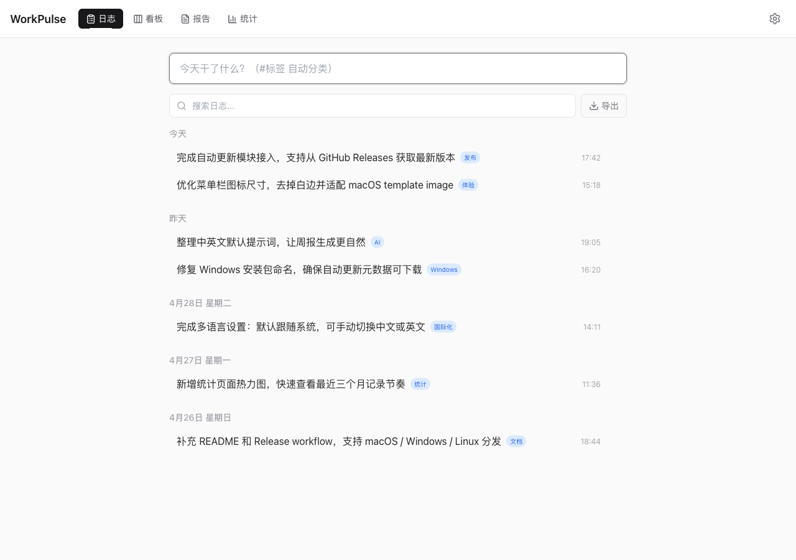
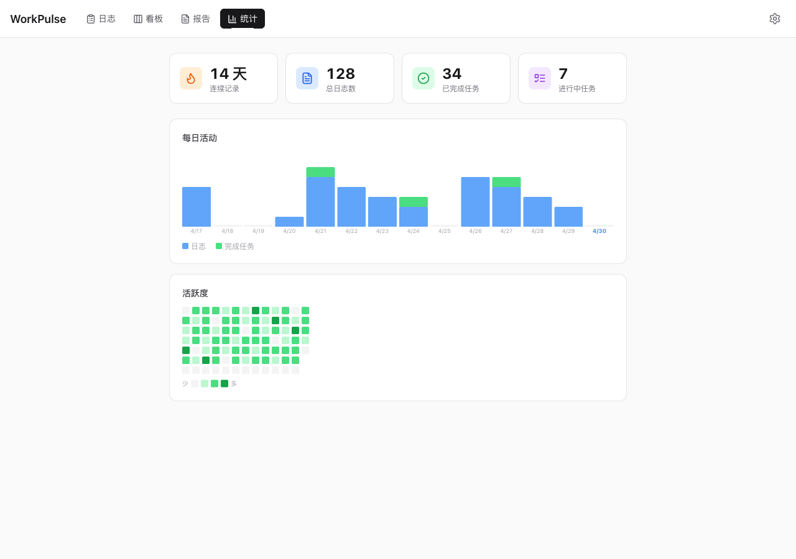

# WorkPulse

[English](./README.md) | [中文](./README.zh-CN.md)

> 让每一份努力被看见

A lightweight desktop app that captures your daily work in seconds — log what you did, track tasks on a kanban board, and generate AI-powered reports.

Built for individual contributors who want a frictionless way to remember what they accomplished each day.

## Screenshots

| Work Log                                            | Kanban                                           |
| --------------------------------------------------- | ------------------------------------------------ |
|  |  |

| AI Report                                           | Statistics                                          |
| --------------------------------------------------- | --------------------------------------------------- |
|  |  |

## Features

**Work Log** — Type what you just did, press Enter. That's it. Supports `#tag` for auto-categorization, full-text search, undo delete, and CSV/Markdown export with categories.

**Kanban Board** — Drag tasks between Todo → In Progress → Done. Includes a draft box for "maybe later" ideas, due date tracking, and inline editing. Completing a task auto-generates a work log entry.

**AI Reports** — Select a date range and generate a structured summary of your work with streaming rendering (thinking-process collapsible). Reports are auto-saved to history on completion and can be previewed, edited, copied, or exported.

**AI Chat** — Built-in multi-conversation chat with provider presets for DeepSeek/OpenAI/Anthropic/Zhipu/Moonshot/Qwen/Gitee/Ollama, connection testing, config import/export, live token usage and cost estimation.

**Calendar** — Manage todos and meetings on a perpetual calendar view with automatic Chinese holiday/substitute-workday data. Meeting reminders fire system notifications ahead of the configured lead time and can also be pushed to your iPhone via Bark.

**Local AI Models** — ONNX model chat, OCR text recognition, PaddleOCR, and XRay image processing. Models download via the hf-mirror.com China mirror into a local folder cache, reused across pages, with WebGPU acceleration and retry on failure.

**Statistics** — 3D contribution graph (React Three Fiber), stacked bar chart, donut breakdown, category distribution, streak counter, with one-click range switching from 1 month to 1 year.

**Quick Capture** — Configurable global shortcuts (`Ctrl+Shift+L` for logs, `Ctrl+Shift+T` for tasks by default) let you record without switching windows. Quick logs also support `#tag` parsing and are accessible from the menu bar tray icon.

**Dark Mode** — System, light, or dark theme with full UI coverage, unified through a design-token color system.

**Languages** — English and Chinese UI with a system-default option. Menus, tray actions, settings, exports, and default AI report prompts follow the selected language.

**Auto Updates** — Packaged builds check GitHub Releases for newer versions, download updates in the background, and install after restart. Settings also includes a manual update check.

**Windows Mica Effect** — Native `backgroundMaterial` (Mica / Mica Tabbed / Acrylic, switchable in Settings) with unified title bar, navigation, and content painting for a seamless frosted-glass desktop integration.

## Tech Stack

- **Electron** + **React** + **TypeScript**
- **Vite** via electron-vite for fast builds
- **SQLite** (better-sqlite3) for local-first data storage
- **Zustand** for state management
- **@dnd-kit** for drag-and-drop
- **Tailwind CSS** with a design-token system
- Native `backgroundMaterial` for Windows Mica effect
- **React Three Fiber** + **Three.js** for the 3D contribution graph
- **ECharts** for statistics charts
- **Transformers.js** for local AI model inference (WebGPU)

## Getting Started

```bash
# Install dependencies
npm install

# Run in development
npm run dev

# Build for production
npm run build

# Package for distribution
npm run dist:mac    # macOS (DMG + ZIP, x64 + arm64)
npm run dist:win    # Windows (NSIS installer)
npm run dist:linux  # Linux (AppImage)
```

## 开发与验证

所有命令都可直接在本机运行，不需要额外手工点窗口确认。

| 命令                   | 作用                                                          |
| ---------------------- | ------------------------------------------------------------- |
| `npm test`             | Vitest 单元测试（`tests/unit`，jsdom + Testing Library）      |
| `npm run test:watch`   | 单元测试监视模式，改代码即重跑                                |
| `npm run test:e2e`     | 先构建，再用 Playwright 启动真实 Electron 窗口做 GUI 冒烟验证 |
| `npm run typecheck`    | 主进程 / 渲染进程两段 TypeScript 检查                         |
| `npm run lint`         | Oxlint 静态检查                                               |
| `npm run format:check` | 代码与文档格式检查                                            |
| `npm run build`        | 全量构建 main / preload / renderer                            |
| `npm run audit:glass`  | 玻璃效果 GPU 预算审计                                         |

单元测试覆盖动效 token 契约、主题切换的扩散与 reduced-motion 降级、Toast 定时器去重、命令面板执行锁、强调色事件广播。`tests/setup.ts` 统一补齐 jsdom 缺少的 `matchMedia` / WAAPI / `scrollIntoView`。

GUI 验证会检查主窗口渲染、原生 View Transition 支持、点击主题按钮是否触发扩散与底色补齐、减少动态偏好下是否跳过动画、命令面板快捷键开关，并把截图写到 `test-results/`。该模式通过 `WORKPULSE_E2E=1` 与临时 `userData` 完全隔离：跳过单实例锁、全局快捷键、托盘、协议注册与更新检查，不碰真实数据库和注册表。验证失败时保留临时 `userData` 并打印主进程日志末尾，便于自行排查。新增渲染层用例放 `tests/unit`，新增窗口级用例放 `tests/e2e`。

## Installation

### macOS

Because the build is unsigned, macOS Gatekeeper will mark the app as "damaged" on first launch. After dragging `WorkPulse.app` to `/Applications`, run this once in Terminal to clear the quarantine attribute:

```bash
xattr -cr /Applications/WorkPulse.app
```

Then open the app normally.

### Windows

Download the NSIS installer from [Releases](../../releases). Run the installer and follow the prompts. The app will be installed to your Program Files directory.

## Release Builds

GitHub Actions builds release artifacts for macOS, Windows, and Linux when a `v*` tag is pushed, or when the `Release` workflow is run manually.

```bash
npm run release        # interactive version picker; auto commit + tag + push
```

Update [CHANGELOG.md](./CHANGELOG.md) before releasing. The workflow uploads DMG/ZIP, NSIS/portable EXE, AppImage, and DEB artifacts to the GitHub Release. Builds are unsigned by default; add signing secrets later if you need notarized macOS or signed Windows installers.

Packaged apps use the same GitHub Release metadata (`latest.yml`, `latest-mac.yml`, `latest-linux.yml`) for automatic update checks.

## Keyboard Shortcuts

| Shortcut        | Action              |
| --------------- | ------------------- |
| `⌘1` / `Ctrl+1` | Switch to Work Log  |
| `⌘2` / `Ctrl+2` | Switch to Kanban    |
| `⌘3` / `Ctrl+3` | Switch to Reports   |
| `⌘4` / `Ctrl+4` | Switch to Stats     |
| `⌘,` / `Ctrl+,` | Settings            |
| `Ctrl+Shift+L`  | Quick log (global)  |
| `Ctrl+Shift+T`  | Quick task (global) |

## Data & Security

All data is stored locally in SQLite at your system's app data directory. Automatic daily backups are created. API keys are stored through Electron secure storage when available, with migration cleanup for legacy plaintext keys. No cloud, no account, no telemetry.

## License

MIT
